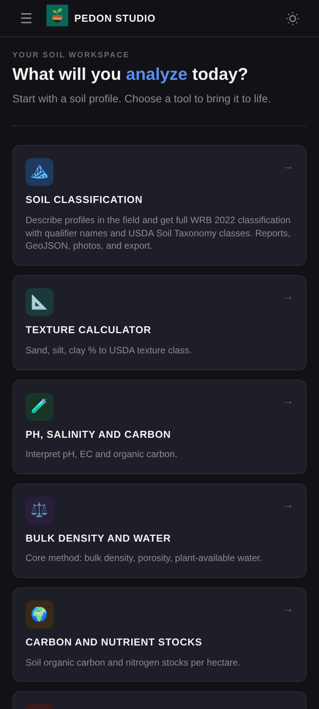
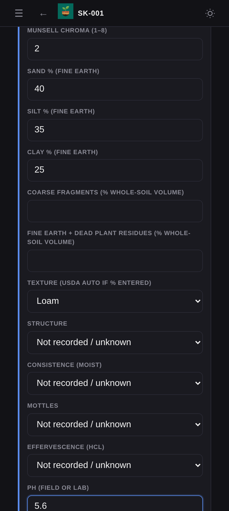
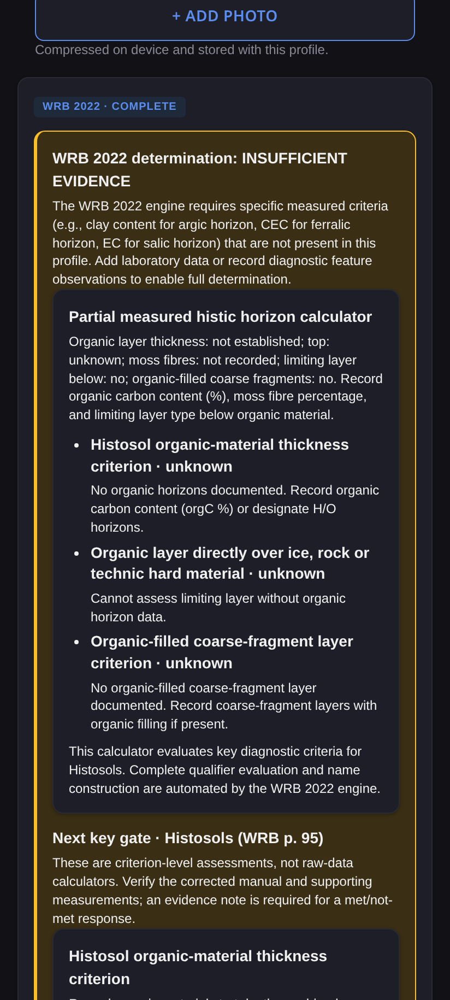
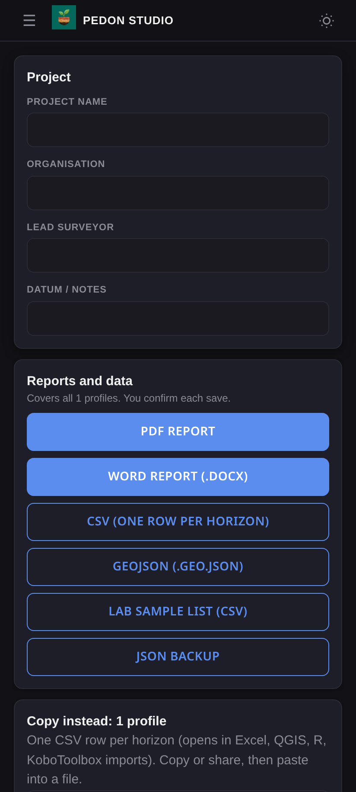
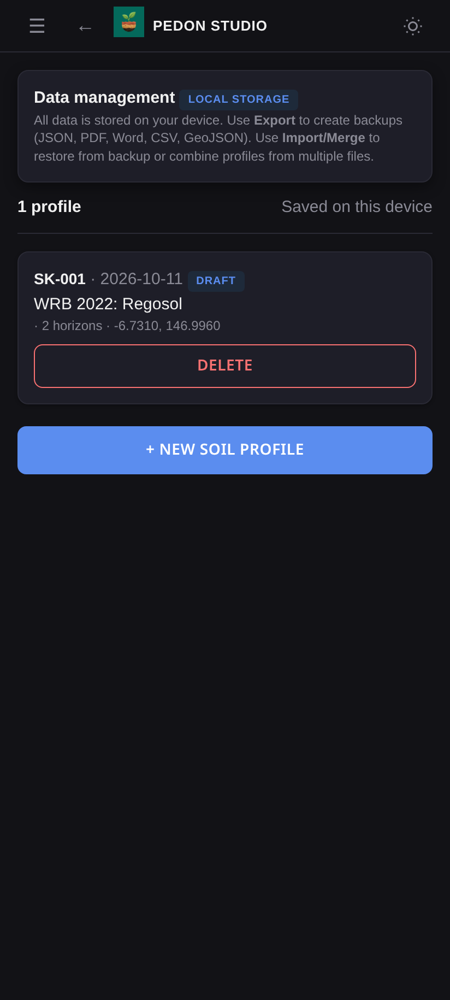
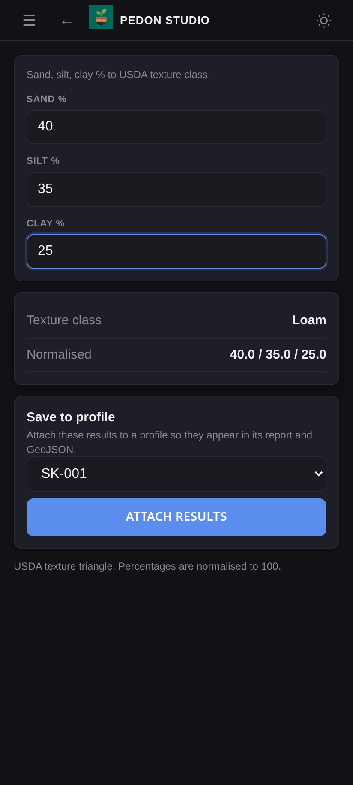
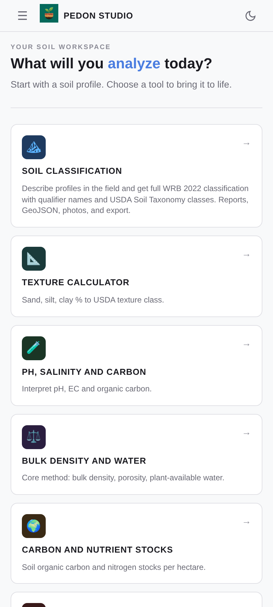
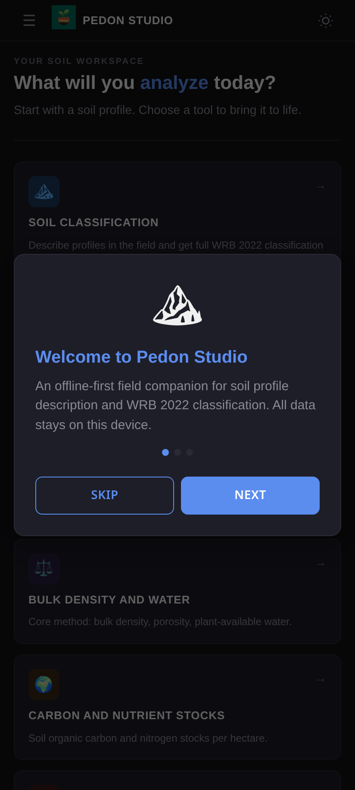
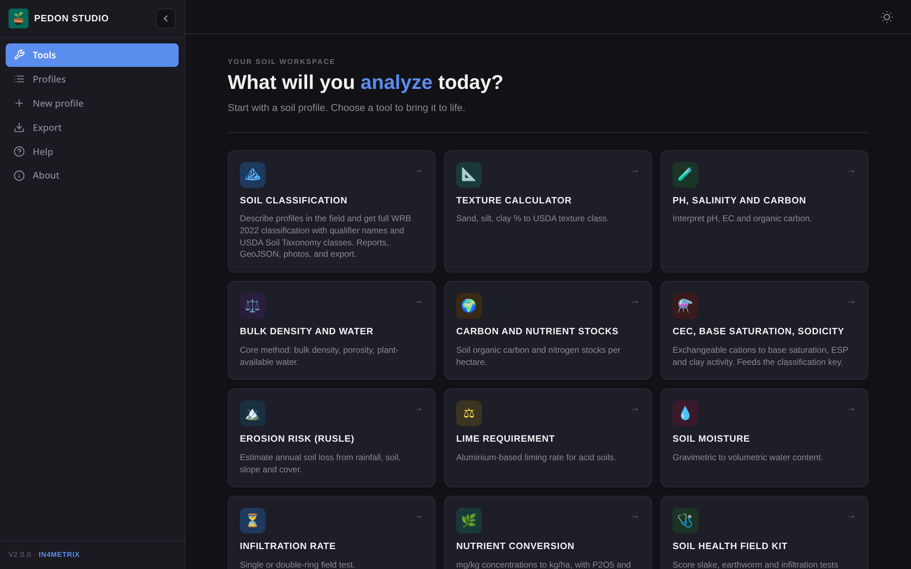

<p align="center"></p>

# Pedon Studio

<p align="center"><b>Offline-first field companion for soil profile description and WRB 2022 classification</b></p>

<p align="center">
  <a href="docs/USER_GUIDE.md">User Guide</a> ·
  <a href="#screenshots">Screenshots</a> ·
  <a href="#features">Features</a> ·
  <a href="#wrb-2022-engine">WRB 2022 Engine</a> ·
  <a href="#release">Release</a> ·
  <a href="#tests">Tests</a> ·
  <a href="#build-locally">Build</a>
</p>

---

A self-contained Android Studio project targeting Android 10 or newer (API 29+), using an offline WebView asset loader, and writing reports to `Downloads/Pedon` through a narrowly scoped native bridge. The launcher uses the seedling-and-layered-soil concept as an Android adaptive icon, with its artwork kept inside the launcher safe area.

## Screenshots

<p align="center">
  
  
  
  
</p>
<p align="center">
  
  
  
  
</p>
<p align="center"></p>

New to the app? Read the **[User Guide](docs/USER_GUIDE.md)**.

## Features

- **Offline-first** — All data stays on device; no internet required for field work
- **WRB 2022 classification** — 22 diagnostic calculators covering all 32 Reference Soil Groups
- **Qualifier system** — Principal and supplementary qualifier evaluation with depth specifications
- **Final WRB names** — Evidence-based soil name generation per the corrected manual
- **Field tools** — Texture calculator, CEC/base saturation, carbon stocks, RUSLE erosion, lime requirement, and more
- **Photo support** — Capture and attach field photos to profiles
- **GPS integration** — Record coordinates with accuracy
- **Multiple exports** — PDF report, Word (.docx), CSV, GeoJSON, JSON backup
- **Dark/light mode** — Automatic theme with manual toggle
- **Lab data entry** — Full per-horizon laboratory fields (SOC, CEC, ECe, CaCO₃, gypsum, BD, oxalate/dithionite Fe-Al-Si, phosphate retention, sulfide S, mineralogy, method references)

## WRB 2022 Engine

The classification engine (`wrb2022.js`) implements the complete WRB 2022 key:

- **22 diagnostic calculators** covering all 32 Reference Soil Groups
- **Technosols** (artefact layers, geomembranes, technic hard materials) and **Cryosols** (cryic horizons, permafrost, cryogenic alteration)
- **Qualifier evaluation** with principal and supplementary qualifier selection per RSG
- **Depth specifications** (Epi-, Endo-, etc.) applied based on horizon position
- **Final WRB name generation** with evidence-based determination

### 32 RSG Coverage

| Group | Calculator | | Group | Calculator |
|-------|-----------|-|-------|-----------|
| Histosols | Histic | | Anthrosols | Anthropogenic |
| Technosols | Technosol | | Cryosols | Cryosol |
| Leptosols | Leptosol | | Solonetzes | Natric |
| Vertisols | Vertic | | Solonchaks | Solonchak |
| Gleysols | Gleyic | | Andosols | Andic |
| Podzols | Spodic | | Plinthosols | Plinthic |
| Planosols | Stagnic | | Stagnosols | Stagnic |
| Nitisols | Nitic | | Ferralsols | Ferralic |
| Chernozems | Mollic/Umbric/Chernic | | Kastanozems | Mollic/Umbric/Chernic |
| Phaeozems | Mollic/Umbric/Chernic | | Umbrisols | Mollic/Umbric/Chernic |
| Durisols | Duric | | Gypsisols | Calcic/Gypsic |
| Calcisols | Calcic/Gypsic | | Retisols | Argic |
| Acrisols | Argic | | Lixisols | Argic |
| Alisols | Argic | | Luvisols | Argic |
| Cambisols | Cambic | | Fluvisols | Fluvic |
| Arenosols | Arenosol | | Regosols | (fallback) |

### Primary Reference

[IUSS Working Group WRB. 2022. World Reference Base for Soil Resources. 4th edition, corrected 24 September 2024.](https://wrb.isric.org/files/WRB_fourth_edition_2022-12-18_errata_correction_2024-09-24.pdf)

### Qualifier-list audit

A direct audit (not shipped in this repository) extracted the corrected manual's Chapter 4 tables (printed pp. 95–126) and compared them with the reference-only `soilKey` per-RSG YAML. It found 661 principal and 1,167 supplementary table entries in the manual. The corrected manual controls, including its 2024 changes. `soilKey` is kept as reference material only and is not integrated or packaged as Pedon's classifier.


## Release

| Field | Value |
|-------|-------|
| **Version** | `2.0.2` (versionCode 7) |
| **Build types** | `debug` (testing), `release` (production) |
| **APK name** | `Pedon-Studio-{version}-{type}.apk` |
| **Architecture** | Universal (arm64-v8a, armeabi-v7a, x86_64) |
| **Minimum SDK** | API 29 (Android 10) |
| **Target SDK** | API 35 (Android 15) |
| **Application ID** | `org.pedon.app` |
| **User guide** | [docs/USER_GUIDE.md](docs/USER_GUIDE.md) |
| **Signing guide** | [SIGNING.md](SIGNING.md) |
| **Privacy policy** | [PRIVACY.md](PRIVACY.md) |
| **Security** | [SECURITY.md](SECURITY.md) |
| **License** | Apache 2.0 |

The 2.0.0 milestone marks the completion of the WRB 2022 engine: 22 diagnostic calculators covering all 32 Reference Soil Groups, qualifier evaluation with depth specifications, and evidence-based final WRB name generation.

## Download

Download from **[pedonstudio.in4metrix.dev](https://pedonstudio.in4metrix.dev)** or from [GitHub Releases](https://github.com/jm0535/pedon/releases/latest):

| File | Use |
|---|---|
| `Pedon-Studio-2.0.2-release.apk` | Recommended build for sideloading (1.6 MB, signed with the Pedon release key) |
| `Pedon-Studio-2.0.2-debug.apk` | Testing build (`org.pedon.app.debug`, installs alongside the release build) |
| `SHA256SUMS` | Checksums — verify with `sha256sum -c SHA256SUMS` |

Release signing certificate SHA-256: `6a:81:69:7f:00:b4:ce:78:ed:dd:fc:a8:58:ae:ef:3b:da:d1:a5:ee:b3:30:70:f0:62:d7:d5:6b:58:93:a7:ad`

> **Upgrading from 2.0.0:** 2.0.0 was signed with the debug key; 2.0.1 and later use the new release key, so Android will not install it over 2.0.0. Export a JSON backup, uninstall 2.0.0, install 2.0.2 and restore the backup.

See the **[User Guide](docs/USER_GUIDE.md)** for installation and usage.

## Build

### Debug (for local testing)

```sh
./gradlew assembleDebug
```

Output: `app/build/outputs/apk/debug/Pedon-Studio-2.0.2-debug.apk`

The debug build has a `.debug` suffix on the package name (`org.pedon.app.debug`) so it can coexist with the release build on the same device.

### Release (for Play Store / F-Droid / sideload)

1. Generate a release keystore (one time):
   ```sh
   ./tools/generate_release_keystore.sh
   ```
2. Configure signing in `~/.gradle/gradle.properties` (see [SIGNING.md](SIGNING.md))
3. Build:
   ```sh
   ./gradlew assembleRelease
   ```
4. Output: `app/build/outputs/apk/release/Pedon-Studio-2.0.2-release.apk`

Or use the helper script:
```sh
./tools/release_build.sh --test     # runs tests, then builds release
./tools/release_build.sh --debug    # builds debug APK
```

### Verify APK integrity

```sh
sha256sum app/build/outputs/apk/release/Pedon-Studio-2.0.2-release.apk
apksigner verify --verbose app/build/outputs/apk/release/Pedon-Studio-2.0.2-release.apk
```

## Distribution

### Google Play Store
- Upload `Pedon-Studio-2.0.2-release.apk` to Play Console
- No internet permission declared (offline-first)
- GPS and camera permissions are optional and granted at runtime

### F-Droid
- F-Droid builds from source using `.f-droid/metadata/`
- All dependencies are Apache 2.0 (AndroidX only)
- No proprietary libraries, no Google Play Services, no tracking

## Tests

```
Pedon smoke tests passed.
✓ All vertic calculator tests passed
  ✓ nitic-horizon calculator tests
  ✓ technosol calculator tests
  ✓ cryosol calculator tests
```

Run `node tests/smoke.js && node tests/qualifier-rules-tests.js`. Each suite prints its assertion count: currently **363 + 52 = 415 assertions, all passing**, including XSS regression checks on imported backups.

## Build locally

Requirements: Android SDK Platform 35 and build-tools 35.0.0, **JDK 17** (Gradle 8.9 does not run on newer JDKs such as 25), and internet access for the first Gradle sync. Android Studio is optional.

```sh
export JAVA_HOME=/path/to/jdk-17 ANDROID_HOME=/path/to/android-sdk
./gradlew assembleDebug assembleRelease
```

Outputs:

```text
app/build/outputs/apk/debug/Pedon-Studio-2.0.2-debug.apk
app/build/outputs/apk/release/Pedon-Studio-2.0.2-release.apk
```

If no release keystore is configured, the release build falls back to the debug key (fine for local testing only).

### Publish a release

APKs are not committed to the repository. To publish a new version:

1. Bump `versionCode` and `versionName` in `app/build.gradle.kts` and add a section to `.f-droid/metadata/en-US/changelog.txt`.
2. Run:
   ```sh
   ./tools/publish_release.sh
   ```
   This runs the tests, builds both APKs, refuses to continue if the release APK is debug-signed, creates the GitHub Release `v<version>` with the APKs and `SHA256SUMS` (using the changelog section as notes), and writes `site/release.json`.
3. Commit and push `site/release.json`; the website then links to the new files.

GitHub Releases does not use GitHub Actions minutes.

## GitHub Actions

Two workflows are included (optional): **Build Pedon APK** (`build.yml`) runs the smoke and qualifier tests, builds `assembleDebug` and uploads `pedon-debug-apk` for 14 days; **Build APK** (`build-apk.yml`) builds and uploads the debug APK. They require GitHub Actions minutes on the account. When Actions is unavailable, build and publish locally (above).

## Download website

`site/` is the static download page served at https://pedonstudio.in4metrix.dev via Vercel. `vercel.json` runs `site/build.sh`, which copies the screenshots and logo into `site/` and renders `docs/USER_GUIDE.md` to `/guide` (via `site/build-guide.mjs`, Node only, no dependencies). The download buttons, version, size and checksums come from `site/release.json`, so the page always points at the latest published GitHub Release.

Preview locally:

```sh
sh site/build.sh && python3 -m http.server 8080 --directory site
```

## Offline/privacy notes

- The manifest does not request Internet access; the app has no online sync.
- GPS is requested at runtime. Photo/gallery selection uses Android's document picker; camera capture is offered where a camera app is available.
- Exports are written using MediaStore into `Downloads/Pedon`; no broad storage permission is used.
- Profile data and embedded downsized photos are stored in WebView local storage. This has finite capacity; export backups regularly.
- Android cloud backup and device-to-device transfer are disabled (`allowBackup="false"` plus `data_extraction_rules.xml` for Android 12+), so sensitive coordinates and notes are not copied off the device. Use the in-app JSON export to back up data.
- External `https` links tapped by the user open in the system browser; the WebView itself only loads the bundled app.

## Security

See [SECURITY.md](SECURITY.md) for the security model, controls and how to report a vulnerability.

## Repository

[https://github.com/jm0535/pedon](https://github.com/jm0535/pedon)

## Developer & Publisher

**in4metrix** — [www.in4metrix.dev](https://www.in4metrix.dev)
