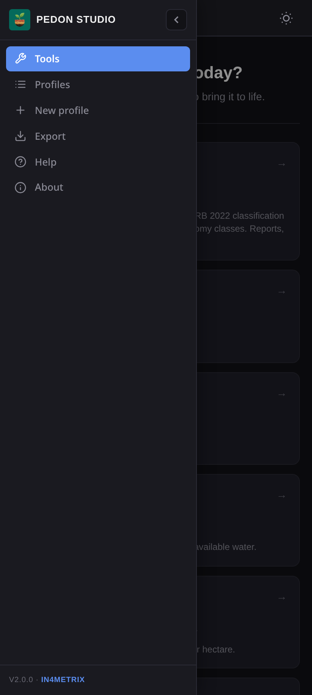
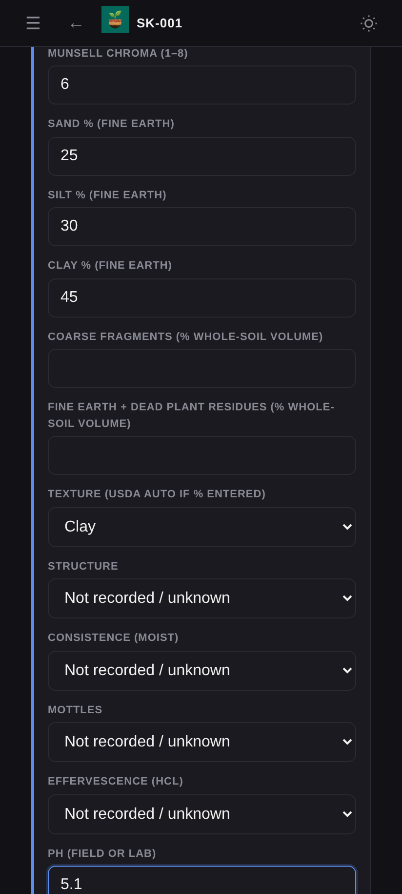

# Pedon Studio — User Guide

Pedon Studio is an offline field companion for describing soil profiles and classifying them with WRB 2022. Everything you enter stays on your device. No internet connection is needed.

- [1. Install](#1-install)
- [2. First launch](#2-first-launch)
- [3. Navigating the app](#3-navigating-the-app)
- [4. Describe a soil profile](#4-describe-a-soil-profile)
- [5. WRB 2022 classification](#5-wrb-2022-classification)
- [6. Manage profiles](#6-manage-profiles)
- [7. Field tools](#7-field-tools)
- [8. Export and back up](#8-export-and-back-up)
- [9. Dark and light mode](#9-dark-and-light-mode)
- [10. Privacy and storage](#10-privacy-and-storage)
- [11. Troubleshooting](#11-troubleshooting)

---

## 1. Install

1. On an Android 10 (or newer) phone or tablet, download the APK from [pedonstudio.in4metrix.dev](https://pedonstudio.in4metrix.dev/#download) or from [GitHub Releases](https://github.com/jm0535/pedon/releases/latest).
2. Open the file and allow installation from this source when Android asks.
3. Optionally check the file against the SHA-256 checksum shown on the download page.

**Upgrading from 2.0.0?** Version 2.0.1 is signed with a new key, so Android won't install it over 2.0.0. In 2.0.0, go to **Export → JSON backup**, uninstall 2.0.0, install 2.0.1, then restore the backup with **Import/Merge**.

`Pedon-Studio-2.0.1-debug.apk` is a testing build. It installs alongside the release build as a separate app.

## 2. First launch

A three-step welcome screen introduces the app. Tap **Next** to step through it or **Skip** to close it. It only appears the first time.

## 3. Navigating the app

 

The **Tools** screen is the home page. On a phone, tap **☰** (top left) to open the menu; on a tablet or desktop the menu is always visible on the left and can be collapsed with the **‹** button.

| Menu item | What it does |
|---|---|
| **Tools** | Home screen with soil classification and 19 calculators |
| **Profiles** | List of saved soil profiles |
| **New profile** | Start describing a new profile |
| **Export** | Reports, data files and backups |
| **Help** | Built-in guide, diagnostic horizon table and FAQ |
| **About** | Version, standards and references |

The **←** button in the header goes back to the previous screen.

## 4. Describe a soil profile

 

Tap **New profile**. A profile ID such as `SK-001` is created automatically. Changes save as you type.

**Site** — date, observer, elevation, GPS, landform, slope, parent material, drainage, land use and notes.
Tap **Capture GPS** to record the device position; it works without mobile signal as long as location is switched on. You can also type coordinates (WGS84 decimal degrees).

**Horizons** — tap **+ Add horizon** for each layer. For each one record:

- Designation (O, A, E, Bw, Bt, Bg, C, R…), top and bottom depth (cm)
- Moist Munsell hue, value and chroma — the colour swatch updates as you type
- Sand, silt and clay % — the USDA texture class is filled in automatically when they add up to about 100
- Coarse fragments, structure, consistence, mottles, effervescence and pH

Open **Laboratory results** under a horizon to enter SOC, CEC, base saturation, ECe, CaCO₃, gypsum, bulk density, oxalate/dithionite Fe–Al–Si, phosphate retention and more. Leave unmeasured values blank — blank means *unknown*, never zero.

**Diagnostic features** — for each feature choose *Observed present*, *Assessed absent* or leave it *Not assessed*.

**Photos** — tap **+ Add photo** to take or choose pictures. They are resized on the device and stored with the profile.

## 5. WRB 2022 classification

The result panel at the bottom of the profile updates live. It shows:

- The WRB 2022 determination, or **INSUFFICIENT EVIDENCE** when the data needed for the next step of the key is missing
- Each diagnostic calculator that applies, with every criterion marked **met**, **not met** or **unknown** and a note on what to record
- **Next key gate** — the Reference Soil Group the key is checking, with its page in the WRB manual. You can record a verified status and an evidence note for each criterion so the key can continue

When enough evidence exists the engine adds principal and supplementary qualifiers and builds the full name (for example *Epiargic Skeletic Dystric Luvisol*). The approximate USDA Soil Taxonomy order is shown alongside.

> Always confirm classifications against the WRB 2022 manual (4th edition, corrected 24 September 2024) and laboratory data before publishing.

## 6. Manage profiles

**Profiles** lists every saved profile with its date, status, classification, number of horizons and coordinates. Tap a profile to open it. To delete, tap **Delete** and then tap it again to confirm.

## 7. Field tools

The Tools screen has 19 calculators, including texture, pH/salinity/carbon, bulk density and water, carbon and nutrient stocks, CEC/base saturation/sodicity, RUSLE erosion, lime requirement, soil moisture, infiltration, nutrient conversion and a soil health field kit.

Enter values to see results immediately. Use **Attach results** to save the result to a profile so it appears in that profile's report and GeoJSON.

## 8. Export and back up

Fill in the optional project details, then choose a format:

| Format | Use for |
|---|---|
| **PDF report** | Printable field report |
| **Word report (.docx)** | Editing in Word or LibreOffice |
| **CSV** | Excel, R, QGIS, KoboToolbox (one row per horizon) |
| **GeoJSON** | QGIS, ArcGIS and web maps (one point per profile) |
| **Lab sample list** | Sample submission spreadsheet |
| **JSON backup** | Full backup to restore or move to another device |

On Android files are saved to **Downloads/Pedon**. Further down the screen you can copy or share the CSV text, and paste a JSON backup into **Import/Merge** and tap **Merge into this device** to restore or combine profiles.

> **Back up regularly.** Android system backup is disabled to protect sensitive site data, so uninstalling the app or changing phones deletes your profiles unless you have a JSON backup.

## 9. Dark and light mode

The app follows your device's theme. Tap the sun/moon button in the top-right corner to switch manually; your choice is remembered.

## 10. Privacy and storage

- The app has no internet permission and sends nothing anywhere.
- Location is requested only when you tap **Capture GPS**.
- Profiles and photos are stored in the app's private storage. Large numbers of photos can fill it; export and remove old profiles when needed.

See [PRIVACY.md](../PRIVACY.md) for the full policy.

## 11. Troubleshooting

| Problem | Fix |
|---|---|
| GPS says it can't get a fix | Turn on location, allow the permission, move into the open and wait up to 30 seconds — or type the coordinates |
| "Could not save changes" | Storage is full. Export a JSON backup, then delete large photos or old profiles |
| Classification stays at INSUFFICIENT EVIDENCE | Add the measurements listed under **Next key gate**, or record verified criterion statuses with evidence notes |
| Android says the app can't be installed or conflicts with an existing package | You have 2.0.0 installed; back it up, uninstall it, then install 2.0.1 |
| Texture class didn't fill in | Sand + silt + clay must add up to 100 (±3) |
| Welcome screen won't show again | It only appears once; open **Help** for the same information |

---

Developed and published by **in4metrix** — [www.in4metrix.dev](https://www.in4metrix.dev)
