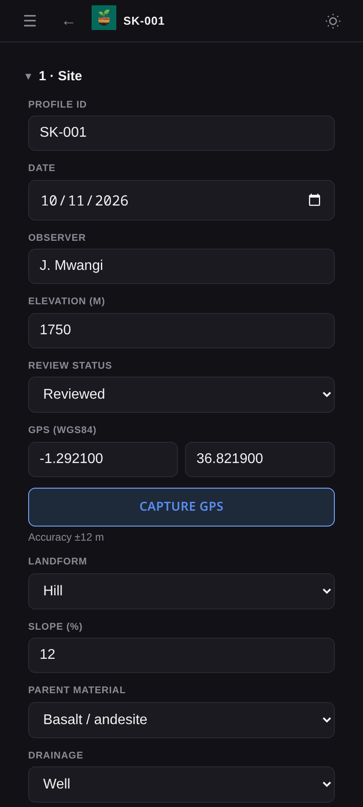
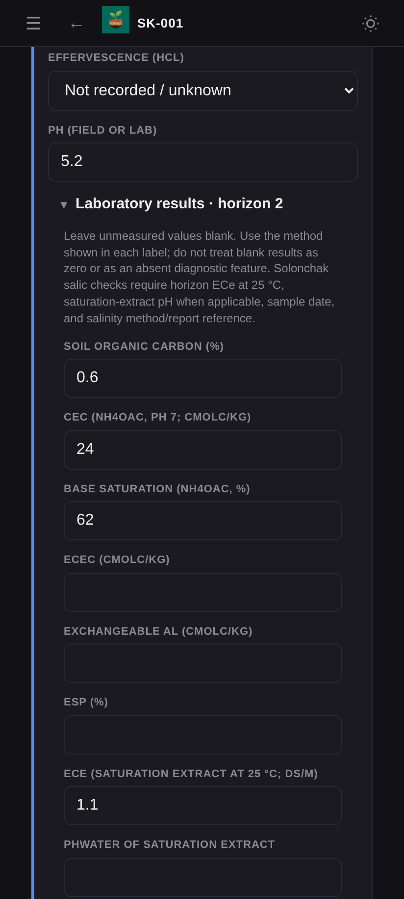
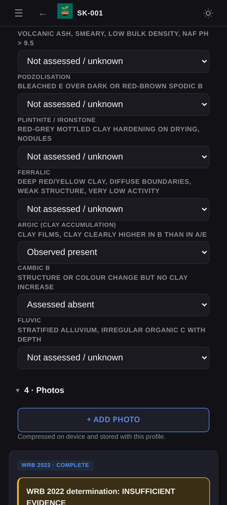
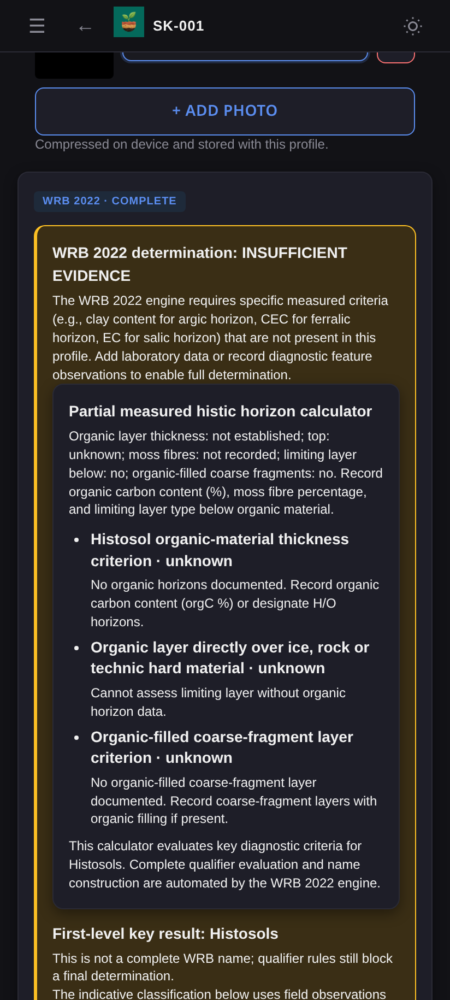
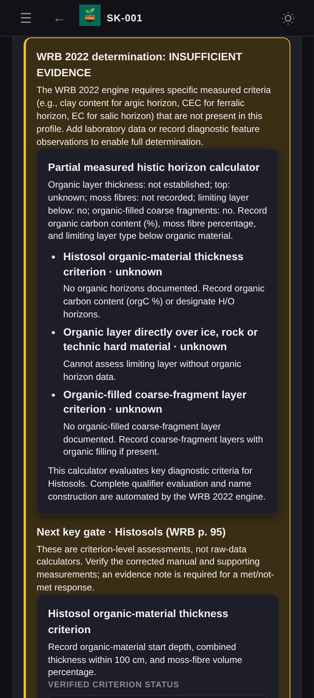
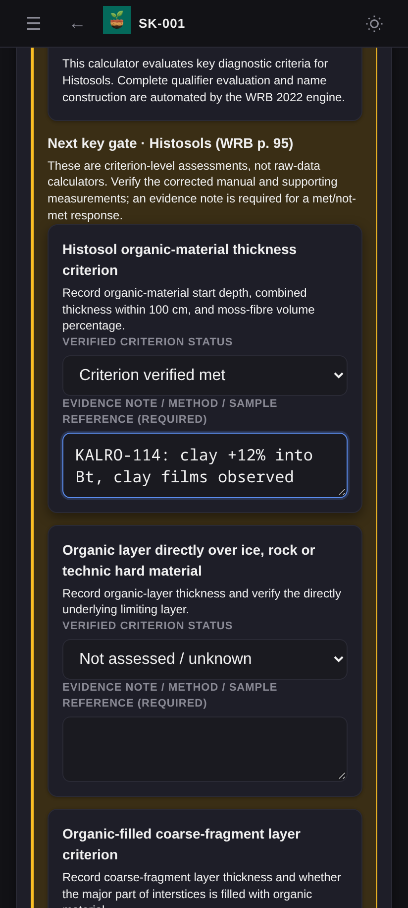
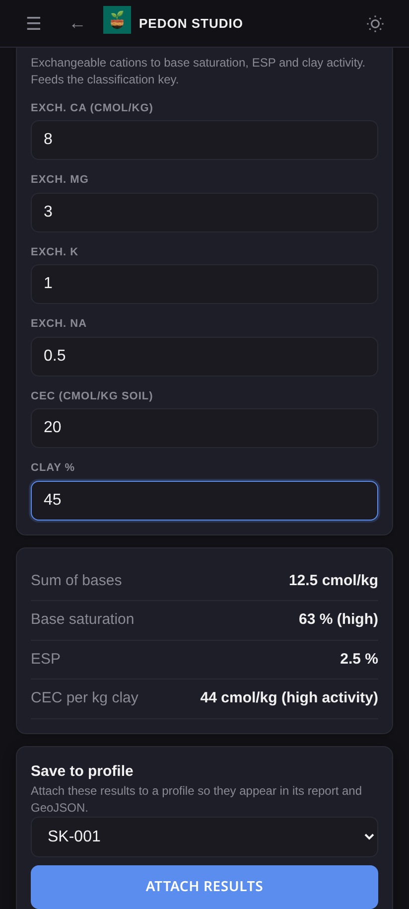
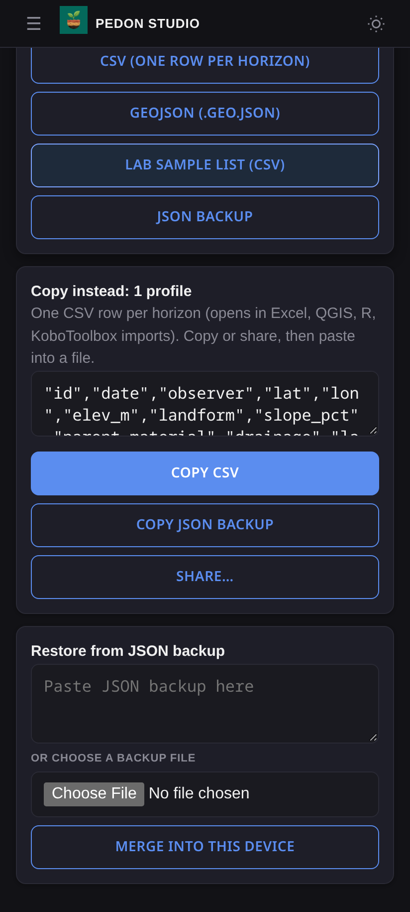
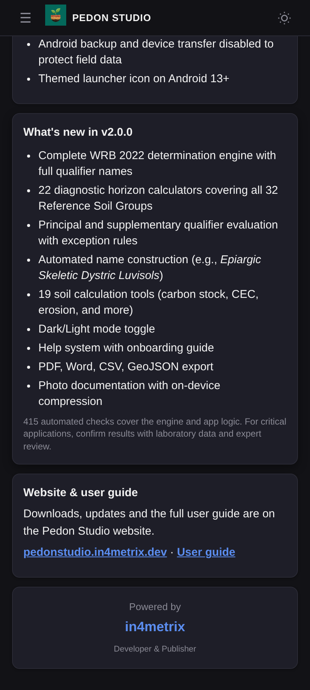

# Pedon Studio — User Guide

Pedon Studio is an offline field companion for describing soil profiles and classifying them with WRB 2022. Everything you enter stays on your device. No internet connection is needed.

- [1. Install](#1-install)
- [2. First launch](#2-first-launch)
- [3. Navigating the app](#3-navigating-the-app)
- [4. Describe a soil profile](#4-describe-a-soil-profile)
- [5. Laboratory results](#5-laboratory-results)
- [6. Diagnostic features](#6-diagnostic-features)
- [7. Photos](#7-photos)
- [8. WRB 2022 classification](#8-wrb-2022-classification)
- [9. Manage profiles](#9-manage-profiles)
- [10. Field tools](#10-field-tools)
- [11. Export and back up](#11-export-and-back-up)
- [12. Dark and light mode](#12-dark-and-light-mode)
- [13. Privacy and storage](#13-privacy-and-storage)
- [14. Troubleshooting](#14-troubleshooting)

---

## 1. Install

1. On an Android 10 (or newer) phone or tablet, download the APK from [pedonstudio.in4metrix.dev](https://pedonstudio.in4metrix.dev/#download). This is the easiest way — the website always offers the latest release.
2. Open the downloaded file and allow installation from this source when Android asks.
3. Optionally check the file against the SHA-256 checksum shown on the download page.

The APK is also on [GitHub Releases](https://github.com/jm0535/pedon/releases/latest).

**Upgrading from 2.0.0?** Version 2.0.1 and later are signed with a new key, so Android won't install them over 2.0.0. In 2.0.0, go to **Export → JSON backup**, uninstall 2.0.0, install the new version, then restore the backup with **Merge into this device**.

`Pedon-Studio-…-debug.apk` is a testing build. It installs alongside the release build as a separate app.

## 2. First launch

A three-step welcome screen introduces the app. Tap **Next** to step through it or **Skip** to close it. It only appears the first time.

## 3. Navigating the app

 

The **Tools** screen is the home page. On a phone, tap **☰** (top left) to open the menu; on a tablet or desktop the menu is always visible on the left and can be collapsed with the **‹** button.

| Menu item | What it does |
|---|---|
| **Tools** | Home screen with soil classification and 19 calculators |
| **Profiles** | List of saved soil profiles |
| **New profile** | Start describing a new profile |
| **Export** | Reports, data files, backups and restore |
| **Help** | Built-in guide, diagnostic horizon table and FAQ |
| **About** | Version, standards, website and user guide links |

The **←** button in the header goes back to the previous screen. Choosing a menu item on a phone closes the menu automatically.

## 4. Describe a soil profile

 

Tap **New profile**. A profile ID such as `SK-001` is created automatically. **Changes save as you type** — there is no save button to forget.

### Site

Record the date, observer, elevation, landform, slope, parent material, drainage, land use and free-text notes, and set a review status (*Draft* or *Reviewed*).

Tap **Capture GPS** to record the device position — it works without mobile signal as long as location is switched on. The accuracy is shown after a fix. You can also type coordinates (WGS84 decimal degrees); the app warns if they are outside the valid range.

### Horizons

Tap **+ Add horizon** for each layer. A new horizon's top depth is filled in from the bottom of the horizon above. For each horizon record:

- **Designation** (O, A, E, Bw, Bt, Bg, C, R…) and **top/bottom depth** in cm
- **Moist Munsell hue, value and chroma** — the colour swatch next to the horizon number updates as you type
- **Sand, silt and clay %** — the USDA texture class fills in automatically when the three add up to about 100
- **Coarse fragments** (% whole-soil volume), **structure**, **consistence**, **mottles**, **effervescence (HCl)** and **pH**
- **Texture by feel** — if you don't have lab percentages, tap this button and answer three hand-texture questions to estimate the class

The classification panel warns you about gaps or overlaps between horizons, missing depths, pH out of range and texture percentages that don't add up to 100.

## 5. Laboratory results

Open **Laboratory results** under each horizon to enter measured data:

- Soil organic carbon (%), CEC (NH₄OAc pH 7), base saturation, ECEC, exchangeable Al, ESP
- ECe (saturation extract at 25 °C) and saturation-extract pH
- CaCO₃ equivalent, gypsum, bulk density
- Oxalate and dithionite Fe, Al and Si; phosphate retention; sulfide sulfur
- Laboratory sample date, mineralogy/method note, lab method/report reference, salinity method reference

**Leave unmeasured values blank.** Blank means *unknown* — never zero. The Solonchak salic check needs ECe at 25 °C, saturation-extract pH where applicable, the sample date and the salinity method reference.

## 6. Diagnostic features

For each field-observable feature choose one of three states:

- **Observed present** — you saw the feature (e.g. cracks and slickensides for vertic, clay films for argic)
- **Assessed absent** — you checked and it is not there
- **Not assessed / unknown** — you did not check; this is the honest default

Also set **Clay activity** (low/high) and **Base status** (auto, low or high — *Auto* uses the mean subsoil pH). These refine the argic candidate split between Acrisol, Lixisol, Alisol and Luvisol.

## 7. Photos

Tap **+ Add photo** to take a picture with the camera or choose one from storage. Photos are resized on the device (they are never uploaded) and stored with the profile. Tap a caption field to describe each photo, and the **X** button to remove one. Keep photos modest — they are stored inside the app and in your JSON backups.

## 8. WRB 2022 classification

 

The result panel at the bottom of the profile updates live as you enter data. It shows one of three states:

- **A final WRB 2022 name** with principal and supplementary qualifiers (for example *Epiargic Skeletic Dystric Luvisols*)
- **INSUFFICIENT EVIDENCE** — the measurements needed for the next step of the key are missing. Each applicable diagnostic calculator shows every criterion as **met**, **not met** or **unknown**, with a note explaining what to record
- **Indicative classification** — a field-level suggestion based on observations, clearly marked as not a final determination

Under **Next key gate** the app names the Reference Soil Group the key is currently checking and its page in the WRB manual. For each listed criterion you can record a verified status (*met* or *not met*) together with an evidence note — the method, lab report or observation that justifies it. Evidence notes are required for a met/not-met response and are stored with the profile and exported in reports.

> Always confirm classifications against the WRB 2022 manual (4th edition, corrected 24 September 2024) and laboratory data before publishing.

## 9. Manage profiles

**Profiles** lists every saved profile with its date, review status, classification, number of horizons and coordinates. Tap a profile to open it. To delete, tap **Delete** and then tap it again to confirm — the second tap protects against accidents.

## 10. Field tools

 

The Tools screen has 19 calculators, including texture, pH/salinity/organic carbon, bulk density and water, carbon and nutrient stocks, CEC/base saturation/sodicity, RUSLE erosion, lime requirement, soil moisture, infiltration, nutrient conversion, a soil health field kit, P retention/andic test, land suitability, sampling planner, multi-layer carbon stock, equivalent soil mass, fertilizer rates, a USLE cover-factor lookup and FAO field-description classes.

Enter values to see results immediately. Use **Attach results** to save a result to a profile so it appears in that profile's report and GeoJSON. The CEC tool also has **Apply to classification**, which sets base status and clay activity on the profile from the exchangeable-cation inputs.

## 11. Export and back up

 

Fill in the optional project details, then choose a format:

| Format | Use for |
|---|---|
| **PDF report** | Printable field report |
| **Word report (.docx)** | Editing in Word or LibreOffice |
| **CSV** | Excel, R, QGIS, KoboToolbox (one row per horizon) |
| **GeoJSON** | QGIS, ArcGIS and web maps (one point per profile) |
| **Lab sample list** | Sample submission spreadsheet |
| **JSON backup** | Full backup to restore or move to another device |

On Android, files are saved to **Downloads/Pedon** and Android asks you to confirm each save. Below the buttons you can copy the CSV text or share it directly.

**Restore:** paste a JSON backup into the text box — or choose a backup file — and tap **Merge into this device**. Profiles that already exist are merged by update time; new profiles are added and duplicate IDs are renumbered automatically. Backups larger than 64 MB are rejected.

> **Back up regularly.** Android system backup is disabled to protect sensitive site data, so uninstalling the app or changing phones deletes your profiles unless you have a JSON backup.

## 12. Dark and light mode

The app follows your device's theme. Tap the sun/moon button in the top-right corner to switch manually; your choice is remembered between sessions.

## 13. Privacy and storage

- The app has no internet permission and sends nothing anywhere.
- Location is requested only when you tap **Capture GPS**.
- Profiles and photos are stored in the app's private storage. Large numbers of photos can fill it; export and remove old profiles when needed.

The **About** and **Help** screens link to the project website ([pedonstudio.in4metrix.dev](https://pedonstudio.in4metrix.dev)) and this user guide, so you can always get back to downloads and documentation from inside the app.

See [PRIVACY.md](../PRIVACY.md) for the full policy.

## 14. Troubleshooting

| Problem | Fix |
|---|---|
| GPS says it can't get a fix | Turn on location, allow the permission, move into the open and wait up to 30 seconds — or type the coordinates |
| "Could not save changes" | Storage is full. Export a JSON backup, then delete large photos or old profiles |
| Classification stays at INSUFFICIENT EVIDENCE | Add the measurements listed under **Next key gate**, or record verified criterion statuses with evidence notes |
| Android says the app can't be installed or conflicts with an existing package | You have 2.0.0 installed; back it up, uninstall it, then install the new version |
| Texture class didn't fill in | Sand + silt + clay must add up to 100 (±3) |
| Delete didn't remove the profile | Tap **Delete** a second time — the first tap only arms it |
| A button on Export did nothing | Downloads are disabled when there are no profiles yet; the app also works without a profile but the export buttons stay greyed out |
| Welcome screen won't show again | It only appears once; open **Help** for the same information |

---

Developed and published by **in4metrix** — [www.in4metrix.dev](https://www.in4metrix.dev) · App downloads and this guide online at [pedonstudio.in4metrix.dev](https://pedonstudio.in4metrix.dev)
